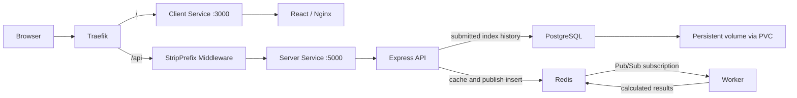
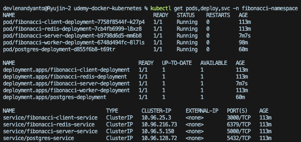
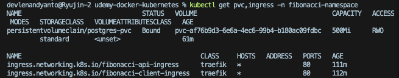
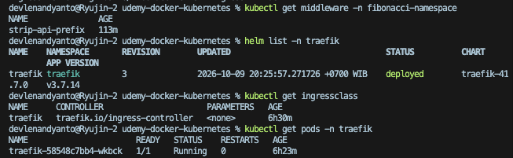
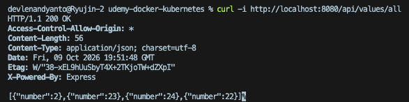
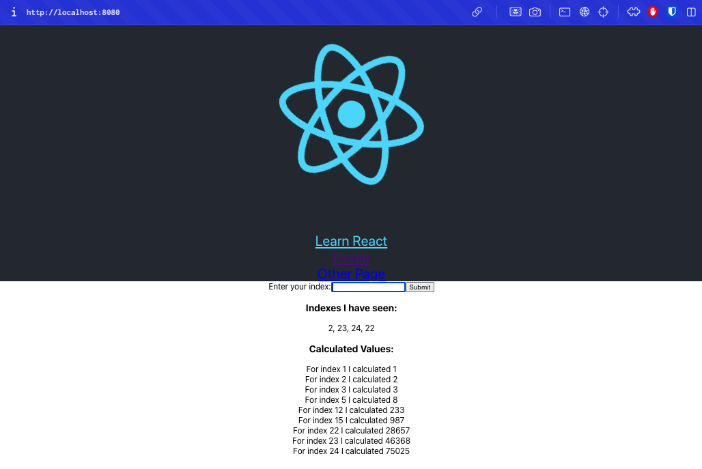

# Sections 12–15 — Fibonacci on Kubernetes

[Back to the repository guide](../README.md) · [Docker application and CI/CD](../section-8/README.md)

## Overview

This completed local lab runs Section 8's React, Express, Redis, Worker, and PostgreSQL application on Kubernetes. It practices Deployments, service discovery, configuration, persistent storage, and HTTP routing through Traefik installed with Helm.

The published Section 8 images are reused; no application Helm chart or separate Kubernetes application source is maintained here. Traefik replaces the standalone Nginx reverse proxy, while the client image still uses Nginx to serve the React build.

This is a resource-constrained **local kind learning environment**, not a production-hardened deployment. The screenshots document a successful run, not current cluster availability.

### Prerequisites

- Docker running, with enough memory and CPU allocated for kind and the five application Pods plus Traefik.
- `kind`, `kubectl`, Helm 3, and `curl` installed locally. The pinned Traefik chart requires Kubernetes ≥1.25.
- Network access to the Traefik Helm repository and container registries. Application manifests pull `chronzon/fibonacci-app-{client,server,worker}:latest` from Docker Hub.
- A kind cluster with a working `standard` StorageClass and provisioner. The PostgreSQL PVC explicitly requests that class.
- A private local file containing a database password for the Secret setup below. Keep it outside this repository and write the intended password without a trailing newline.

No kind cluster configuration is checked in. The walkthrough uses a default disposable kind cluster; an existing cluster can be used if its context and storage provisioner are verified first.

## Architecture



The API's `/values/all` reads PostgreSQL history; `/values/current` reads Redis's `values` hash. Posting an index to `/values` inserts history, sets a placeholder in Redis, and publishes on the `insert` channel. The worker subscribes and replaces the placeholder with its calculation.

Traefik routes `/api` to Express and removes that prefix, so `/api/values/all` becomes `/values/all`. `/` routes to the client. Both Ingress resources use `ingressClassName: traefik`, entrypoint `web`, and no host constraint, allowing access through localhost port-forwarding.

## Resource map

All application resources belong to `fibonacci-namespace`.

| Manifest | Resources and purpose |
| --- | --- |
| [namespace.yaml](k8s/namespace.yaml) | Namespace isolating application resources. |
| [client-deployment.yaml](k8s/client-deployment.yaml) | One client replica and `fibonacci-client-service`, a ClusterIP Service on 3000. |
| [server-deployment.yaml](k8s/server-deployment.yaml) | One API replica and `fibonacci-server-service` on 5000; consumes the ConfigMap and password Secret. |
| [worker-deployment.yaml](k8s/worker-deployment.yaml) | One worker replica, connecting to Redis. No HTTP endpoint or Service is needed. |
| [redis-deployment.yaml](k8s/redis-deployment.yaml) | One Redis replica and `fibonacci-redis-service` on 6379. No persistent volume is configured for Redis. |
| [postgres-deployment.yaml](k8s/postgres-deployment.yaml) | PostgreSQL Deployment (default one replica) and `postgres-service` on 5432; mounts the PVC. |
| [fibonacci-conf.yaml](k8s/fibonacci-conf.yaml) | ConfigMap with Redis endpoint and PostgreSQL host, port, user, and database. `PGHOST` is `postgres-service`. |
| [postgres-secret.yaml](k8s/postgres-secret.yaml) | Sample Opaque Secret named `postgres-auth`, with key `password`. Do not reuse its sample credential publicly; the walkthrough creates a private replacement instead. |
| [postgres-pvc.yaml](k8s/postgres-pvc.yaml) | `postgres-pvc`: 500Mi, `ReadWriteOnce`, filesystem storage using class `standard`. |
| [ingress.yaml](k8s/ingress.yaml) | Separate client and API Ingress resources for `/` and `/api`. |
| [middleware.yaml](k8s/middleware.yaml) | Traefik `strip-api-prefix` Middleware removing `/api` before forwarding to Express. |

Services provide stable DNS names and select Pods using labels; Pod IPs can change. The API obtains its connection settings from `fibonacci-conf`. PostgreSQL derives `POSTGRES_USER` and `POSTGRES_DB` from the same ConfigMap's `PGUSER` and `PGDATABASE`. Both API `PGPASSWORD` and PostgreSQL `POSTGRES_PASSWORD` reference `postgres-auth/password`.

The PostgreSQL PVC binds to a PersistentVolume supplied by the storage provisioner and is mounted at `/var/lib/postgresql/data`. It preserves database files across Pod replacements. It is not a backup: deleting the PVC or the kind cluster can destroy this local data, depending on the storage lifecycle.

### Current resource settings

| Container | CPU request / limit | Memory request / limit |
| --- | --- | --- |
| Client | 50m / 100m | 64Mi / 128Mi |
| Server | 100m / 250m | 128Mi / 256Mi |
| Worker | 100m / 250m | 128Mi / 256Mi |
| Redis | 50m / 100m | 32Mi / 64Mi |
| PostgreSQL | 250m / 500m | 64Mi / 128Mi |

These are the current lab settings after adjustment, not recommended production sizing. Requests influence scheduling; limits constrain usage, and exceeding a memory limit can lead to OOMKilled containers.

## Helm and Traefik

A Helm **repository** distributes charts; a **chart** packages Kubernetes templates; a **release** is an installed instance of a chart. A values file supplies settings for that instance.

The project uses the external `traefik/traefik` chart, release `traefik`, namespace `traefik`, and [helm/traefik-value.yaml](helm/traefik-value.yaml). The values enable Kubernetes Ingress and CRD providers, disable Gateway API features, enable a non-default IngressClass, and set `service.spec.type: ClusterIP`.

The CRD provider is needed for the `traefik.io/v1alpha1` Middleware. The Ingress annotation identifies it as `fibonacci-namespace-strip-api-prefix@kubernetescrd`. Enabling the class alone does not route the application: the Ingress resources explicitly select `traefik`.

The captured installation shows chart **41.7.0**, Traefik **v3.7.14**, and release revision 3. There is no chart lockfile in the repository; the walkthrough pins the captured chart version to avoid silently selecting a different chart.

## Local deployment walkthrough

Run the following from the **repository root**. These are instructions for recreating the lab; documentation review does not require running them.

### 1. Select or create a kind cluster

For a new cluster:

```bash
kind create cluster --name fibonacci-lab
kubectl config use-context kind-fibonacci-lab
kubectl cluster-info
kubectl get storageclass standard
```

For an existing cluster, select its actual context instead of creating another. Verify that `standard` has a working provisioner; a PVC cannot bind merely because a StorageClass name appears in a manifest.

### 2. Install the ingress controller

```bash
helm repo add traefik https://traefik.github.io/charts
helm repo update
helm upgrade --install traefik traefik/traefik \
  --version 41.7.0 \
  --namespace traefik --create-namespace \
  --values section-12-15/helm/traefik-value.yaml \
  --wait --timeout 5m
kubectl get ingressclass traefik
kubectl get crd middlewares.traefik.io
```

Wait for the controller and Middleware CRD before applying the application Ingress and Middleware. The application namespace and Traefik namespace are separate.

### 3. Create the namespace and password Secret

```bash
kubectl apply -f section-12-15/k8s/namespace.yaml
kubectl -n fibonacci-namespace create secret generic postgres-auth \
  --from-file=password=/absolute/path/to/private/postgres-password.txt \
  --dry-run=client -o yaml | kubectl apply -f -
```

Replace the absolute path with your private file. This passes the password through the file rather than embedding it in a command or documentation. Do not print Secret contents. The command creates the Secret consumed by both database and API; it does not change credentials in an already initialized database.

Do not then apply the whole `k8s/` directory: that would also apply `postgres-secret.yaml` and overwrite the private choice with the sample credential.

### 4. Apply application resources

```bash
kubectl apply -f section-12-15/k8s/fibonacci-conf.yaml
kubectl apply -f section-12-15/k8s/postgres-pvc.yaml
kubectl apply -f section-12-15/k8s/postgres-deployment.yaml
kubectl apply -f section-12-15/k8s/redis-deployment.yaml
kubectl apply -f section-12-15/k8s/server-deployment.yaml
kubectl apply -f section-12-15/k8s/worker-deployment.yaml
kubectl apply -f section-12-15/k8s/client-deployment.yaml
kubectl apply -f section-12-15/k8s/middleware.yaml
kubectl apply -f section-12-15/k8s/ingress.yaml
kubectl -n fibonacci-namespace wait --for=jsonpath='{.status.phase}'=Bound \
  pvc/postgres-pvc --timeout=120s
kubectl -n fibonacci-namespace rollout status deployment/postgres-deployment
kubectl -n fibonacci-namespace rollout status deployment/fibonacci-redis-deployment
kubectl -n fibonacci-namespace rollout status deployment/fibonacci-server-deployment
kubectl -n fibonacci-namespace rollout status deployment/fibonacci-worker-deployment
kubectl -n fibonacci-namespace rollout status deployment/fibonacci-client-deployment
```

The manifests have no readiness probes. Deployment availability and Running Pods are useful checks, but application requests are still needed to verify database connectivity and routing.

### 5. Forward Traefik to localhost

Keep this command running in a separate terminal:

```bash
kubectl -n traefik port-forward service/traefik 8080:80
```

Open **http://localhost:8080**. Port-forwarding avoids requiring a cloud LoadBalancer or kind host-port configuration. It exposes the controller locally; it does not bypass its routing rules by forwarding directly to the client.

## Verification

### Resources and Helm release

```bash
kubectl get pods,deploy,svc -n fibonacci-namespace
kubectl get pvc,ingress -n fibonacci-namespace
kubectl get middleware -n fibonacci-namespace
kubectl describe pvc postgres-pvc -n fibonacci-namespace
helm list -n traefik
kubectl get ingressclass traefik
kubectl get pods,svc -n traefik
```

The capture shows all five application Pods Running and all Deployments available at one replica, with four ClusterIP Services.



The PVC is Bound at 500Mi and both Ingress resources select the Traefik class. An empty Ingress ADDRESS is not evidence of failure in this port-forwarded local setup.



The Middleware exists, the Helm release is deployed, and the `traefik` IngressClass and controller Pod are present.



### Application endpoints

With port-forwarding active:

```bash
curl -i http://localhost:8080/
curl -i http://localhost:8080/api/
curl -i http://localhost:8080/api/values/all
curl -i http://localhost:8080/api/values/current
```

Expect the client HTML at `/`, `Hi` at `/api/`, a JSON history array at `/api/values/all`, and the cached calculation data at `/api/values/current`. Submit a small index through the browser, wait for the worker, then reload: the current React code fetches history and calculated values when the component mounts rather than polling after submission.

The captured history endpoint returns HTTP 200 and submitted indexes 2, 23, 24, and 22.



The final application displays both history and calculated results through localhost:8080, confirming the completed React, Express, Redis, Worker, PostgreSQL, and Traefik lab.



## Troubleshooting and lessons learned

The following issues were encountered during this lab. The corrective actions describe the development history; do not reset persistent data merely to reproduce them.

| Confirmed issue | Lesson / correction |
| --- | --- |
| Server and Worker containers were OOMKilled under lower memory limits. | Their resources were adjusted; both now request 128Mi and allow 256Mi. |
| The local kind cluster had limited resources. | Replica counts and resource settings were adjusted; the current application uses one replica per Deployment. |
| PostgreSQL DNS lookup failed. | `PGHOST` did not match the Service name. The current ConfigMap uses `postgres-service`. |
| ConfigMap edits did not change running process environment. | Pods consuming environment variables had to be replaced/restarted to read updated values. |
| Database initialization settings changed but persisted state did not. | `POSTGRES_USER`, `POSTGRES_DB`, and the password initialize an empty data directory only. |
| A database role mismatch blocked connections. | Application connection identity had to agree with the role actually present in the persisted database, not merely the latest ConfigMap. |
| Production-mode Node forced PostgreSQL SSL. | The local database connection failed. The root fix removed forced SSL in Section 8's server source, followed by rebuilding and redeploying the Docker image. A Kubernetes configuration-only workaround was not the final solution. |

For diagnosis, inspect status, events, and logs without displaying Secret values:

```bash
kubectl describe pods -n fibonacci-namespace
kubectl get events -n fibonacci-namespace --sort-by=.lastTimestamp
kubectl logs deployment/fibonacci-server-deployment -n fibonacci-namespace
kubectl logs deployment/fibonacci-worker-deployment -n fibonacci-namespace
kubectl logs deployment/postgres-deployment -n fibonacci-namespace
```

General follow-up actions, when relevant: restart the API Deployment after an environment ConfigMap change (`kubectl rollout restart deployment/fibonacci-server-deployment -n fibonacci-namespace`), then check rollout and endpoints. Publishing a new `latest` image does not itself replace running Kubernetes Pods; the affected Deployment must roll out again to pull it. `imagePullPolicy: Always` applies when a container starts.

The final screenshots confirm the working lab, but production sizing, TLS, probes, backups, immutable image tags, and secret management remain outside this local exercise. Fixing forced SSL for a non-TLS local database does not imply that public production databases should run without TLS.
