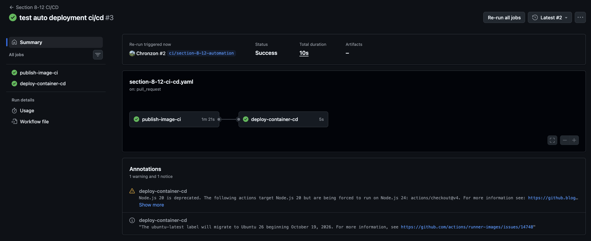
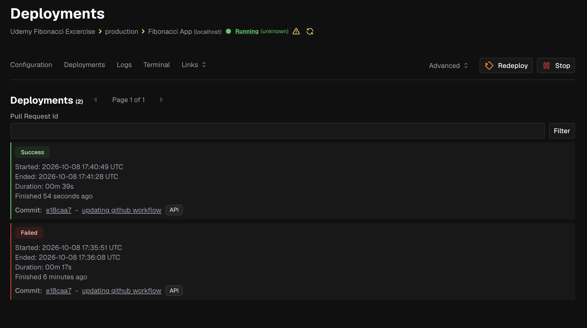
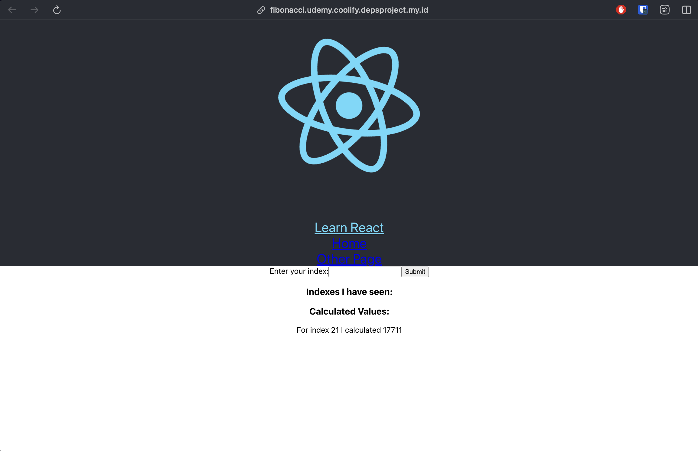

# Section 8 — Building a Multi-Container Application

[Back to the repository guide](../README.md)

## Exercise

[fibonacci-app](fibonacci-app) combines a React client, Node API, background worker, Redis, Postgres, and an Nginx entry point. The project also contains Dockerfiles related to the later multi-service Dockerization material.

```bash
cd fibonacci-app
docker compose -f docker-compose-dev.yaml up --build
```

Open **http://localhost:8888**. The development file builds `Dockerfile.dev` images and mounts local source. The default `docker-compose.yaml` is now the deployment configuration: it uses published Docker Hub images and keeps only the Postgres data volume.

## CI/CD milestone — GitHub Actions to Coolify

The Fibonacci application has reached a working deployment milestone, extending this exercise into the multi-image CI/CD material from later sections. GitHub Actions publishes the application images and triggers a Coolify deployment; the screenshots below capture the successful workflow, deployment, and application result.

```text
Repository change
  → GitHub Actions builds and pushes four images to Docker Hub
  → Deployment job calls the Coolify webhook
  → Coolify deploys the stack
  → Fibonacci application is accessible in the browser
```

The [workflow](../.github/workflows/section-8-12-ci-cd.yaml) runs for pushes to `main` and pull requests targeting `main` when the application or workflow files change. Its current jobs are:

| Job | Responsibility |
| --- | --- |
| `publish-image-ci` | Build and push the server, worker, client, and Nginx images with the `latest` tag. |
| `deploy-container-cd` | Run after image publishing succeeds and call the authenticated Coolify deployment webhook. |

Registry credentials and webhook credentials are supplied through GitHub Actions secrets: `DOCKERHUB_USERNAME`, `DOCKERHUB_PASSWORD`, `COOLIFY_WEBHOOK`, and `COOLIFY_TOKEN`. The workflow currently builds and publishes images; it does not contain a separate automated test job.

### 1. Successful GitHub Actions workflow

Both the image publishing job and the deployment trigger completed successfully.



### 2. Successful Coolify deployment

Coolify records a successful deployment and shows the application as running. The screenshot also preserves an earlier failed attempt, documenting the iteration toward a successful deployment. Its displayed health state is `unknown`, so the deployment status is distinct from a passing application healthcheck.



### 3. Fibonacci application in the browser

The deployed frontend is accessible at the configured domain and displays the calculated result **17711 for index 21**.



These screenshots record the result at the time of capture; they are not a live availability monitor or a complete test of every application route.

## Why production uses two Nginx containers

```text
Browser → Main Nginx :80
            ├── /     → client :3000 → Nginx serves the React build
            └── /api/ → api :5000    → Node.js

API → Postgres + Redis
Worker → Redis
```

During development, the client runs the React dev server on port 3000. In production, the client's final image runs Nginx on that same port. The main Nginx remains the entry point in both cases.

| File | Responsibility |
| --- | --- |
| [nginx/default.conf](fibonacci-app/nginx/default.conf) | Reverse proxy listening on 80, forwarding to `client:3000` and `api:5000`. |
| [client/nginx/default.conf](fibonacci-app/client/nginx/default.conf) | Production static server listening on 3000 and serving the React build. |
| [client/Dockerfile](fibonacci-app/client/Dockerfile) | Builds with Node, then copies the output and client config into an Nginx image. |
| [docker-compose-dev.yaml](fibonacci-app/docker-compose-dev.yaml) | Builds development services and maps host 8888 to the main Nginx port 80. |
| [docker-compose.yaml](fibonacci-app/docker-compose.yaml) | Deploys published images; Nginx exposes internal port 80 for the hosting setup without a host port mapping. |

`listen 80` describes where that Nginx receives requests. `server client:3000` in an upstream describes the destination it forwards requests to.

The client needs its own config because Nginx must actually listen on 3000; `EXPOSE 3000` is only image metadata. Its config includes:

```nginx
try_files $uri $uri/ /index.html;
```

That fallback lets React handle direct requests or refreshes for routes such as `/otherpage` instead of returning a file-not-found response.

The main proxy and static client configs belong in different folders. With build context `./client`, `COPY ./nginx/default.conf ...` reads `client/nginx/default.conf`, not the sibling project's `nginx/default.conf`.

## Nginx images and volumes

The Nginx Dockerfiles use `nginx:1.28-alpine`, fixing a release series rather than following the moving `nginx:alpine` tag. This version choice does not need to match Node's age.

Configs copied into an image do not need bind mounts when they are intended to stay fixed. Rebuild after changing them. Nginx also does not need a project dependency volume comparable to `node_modules`.

## Node versions and startup scripts

The client uses React 18.2 and `react-scripts` 5.0.1. Node 14 fits the historical course setup, but it is end-of-life. The server and worker also use older dependencies; compatibility depends on installed package versions, not the course's age alone.

The server still specifies `body-parser` as `"*"`. A newer resolution may require a newer runtime. Pin a compatible version for repeatable Node 14 exercises, or update and verify the runtime/dependencies together.

The startup command must match each service's `package.json`:

- Client development: `npm run start` (equivalent to `npm start`), which starts the React dev server.
- API development: `npm run dev`; production: `npm run start`.
- Worker development: `npm run dev`; production: `npm run start`.

The name `start` does not inherently mean production: its behavior comes from the script definition.

## Build first, then test integration

From `fibonacci-app`:

```bash
docker build -t fibonacci-client -f client/Dockerfile.dev ./client
docker build -t fibonacci-server -f server/Dockerfile.dev ./server
docker build -t fibonacci-worker -f worker/Dockerfile.dev ./worker
docker compose -f docker-compose-dev.yaml config --quiet
```

Builds catch Dockerfile and installation failures. Compose validates service wiring at runtime, including Redis and Postgres connections. A successful build does not execute `CMD` or prove startup works.

## Postgres initialization versus API connection variables

The Postgres image uses:

```yaml
environment:
  POSTGRES_USER: postgres
  POSTGRES_PASSWORD: postgres_password
  POSTGRES_DB: postgres
```

The API reads these names through [server/keys.js](fibonacci-app/server/keys.js):

```yaml
environment:
  PGUSER: postgres
  PGPASSWORD: postgres_password
  PGDATABASE: postgres
  PGHOST: postgres
  PGPORT: 5432
  REDIS_HOST: redis
  REDIS_PORT: 6379
```

The names differ because different programs read them. User, password, and database values must match. Each service has its own environment; variables are not automatically shared.

Both `PGUSER: postgres` mapping syntax and `- PGUSER=postgres` list syntax are valid under Compose `environment`.

`POSTGRES_*` initializes an empty database directory. Changing these variables does not update credentials in an already initialized database volume.

## Internal ports and startup ordering

Services on the Compose network can reach `postgres:5432` and `redis:6379` without host publishing or `expose` declarations.

- `ports: ["5432:5432"]` publishes to host port 5432.
- `ports: ["5432"]` publishes to an automatically assigned host port.
- Omitting `ports` avoids publishing to the host.

Do not use `:5432` to express an unpublished internal port.

`depends_on` list syntax orders startup but does not guarantee that a database is ready for connections. Readiness can require application retries or a healthcheck with `condition: service_healthy`. The client depending on the API is optional because its dev server can start independently.

## Named volumes

The development Compose declarations omit explicit `name:` overrides. With the default project name `fibonacci-app`, `docker volume ls` shows volumes such as:

```text
fibonacci-app_postgres-data
fibonacci-app_server-node-modules
fibonacci-app_worker-node-modules
fibonacci-app_client-node-modules
```

The prefix can change through `docker compose -p`, `COMPOSE_PROJECT_NAME`, or top-level `name:`. A volume-level `name:` sets an exact name without the project prefix.

Each Node service uses its own dependency volume so a source bind mount does not replace the container's `node_modules`. Postgres uses a persistent data volume.

Renaming a volume does not move its contents; the old volume remains separate. Dependency volumes can retain packages across image rebuilds. When troubleshooting them, distinguish dependency cleanup from deleting persistent database data.

## Deployment configuration

The default [docker-compose.yaml](fibonacci-app/docker-compose.yaml) references the four published images using `${DOCKERHUB_USERNAME}`. Provide that value and the database variables in the deployment environment:

- Postgres initialization: `POSTGRES_USER`, `POSTGRES_PASSWORD`, `POSTGRES_DB`.
- API connection: `PGUSER`, `PGPASSWORD`, `PGDATABASE`.

The corresponding database values must match. Redis and Postgres remain internal services. Nginx declares `expose: 80`, which does not publish a host port; browser access is provided by the hosting configuration.

Production uses image contents rather than development source or dependency mounts, and retains the Postgres data volume. The screenshots above document a successful Coolify deployment and a visible calculation result. Changes to the images, database settings, or hosting configuration still need their own runtime verification.
